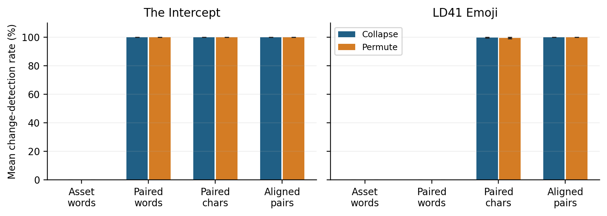
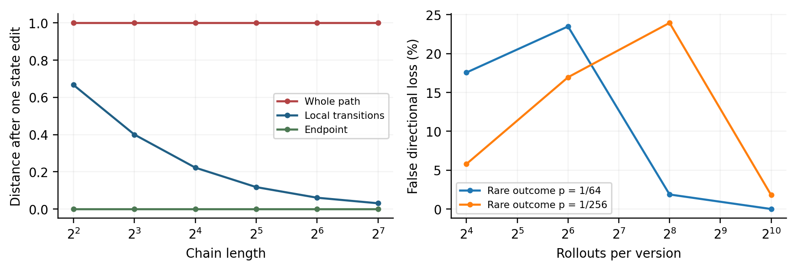

# ABSTRACT

A thousand differently worded endings need not create a new possibility of play. We develop a reproducible instrument audit for novelty-loss benchmarks in human–AI narrative authoring. From two openly licensed Ink games, 400 seeded playthroughs yield 234 valid branching contexts and 679 replay-verified transitions. We evaluate 9,341 nontrivial structural mutations and 936 controls using asset, paired-response and aligned-transition measures. Asset measures miss inventory-preserving routing edits, but paired-response word comparisons detect every tested prose mutation. For the emoji-based game, word comparisons miss consequence reassignment; character comparisons recover almost all cases. Permuting consequences changes action–consequence relations without reducing outcome breadth. Additional tests expose whole-path saturation, annotation sensitivity and false loss from incomplete sampling. The contribution is an executable measurement protocol that separates structural change, retained possibilities and textual variation. These findings concern instrument behaviour, not an estimated causal effect of AI on authors or players.

## Keywords

human–AI co-authorship, narrative novelty, interactive narrative, player choice, benchmark design

# INTRODUCTION

Generative tools can elaborate a scenario while making different writers' work more similar. In games, elaboration can leave the player's available consequences unchanged. Conversely, identical passages can be reused while changing which action leads to which consequence. Evaluating the passage inventory misses that difference. Yet structural change need not mean lost originality: reassigning outcomes can preserve their number, and removing branches can be an artistic decision.

This paper audits instruments for measuring structural variation between aligned versions of an interactive narrative. Its materials are two existing games, runtime-extracted decision contexts and controlled transformations of those records. The study evaluates measurement behaviour before scores are interpreted as evidence about human–AI authoring.

Three research questions organise the study. RQ1 asks which asset-based, paired-response and aligned-transition representations detect controlled action–consequence changes. RQ2 asks when an apparent difference is incorrectly interpreted as loss, including cases where the same endings conceal changed intermediate structure. RQ3 asks how annotation conventions and finite observation affect the stability of those measurements. These questions concern an instrument's suitability before its scores are interpreted as evidence about creative work.

A weak text baseline can be defeated by preserving its input. We therefore compare responses paired to aligned actions. This changes the conclusion: text comparison detects the tested prose edits, while tokenization causes failures in the emoji game. Observation unit, alignment, tokenizer and horizon jointly determine detection.

The contribution is an executable benchmark with saved-state replay, intervention manifests, alternative representations and counterexamples. It distinguishes changes in action–consequence relations, reachable consequence breadth and language. Each can inform an originality evaluation; none establishes originality alone. Novelty loss requires a declared reference and interpretation.

# RELATED WORK

Doshi and Hauser (2024) show why individual and collective evaluations must be separated: AI idea assistance improved assessments of individual short stories while increasing similarity across stories. Padmakumar and He (2024) investigate co-writing with base and feedback-tuned language models and report different diversity effects across assistance conditions. These findings motivate a comparison with specified workflows and model versions, not the assumption that all AI use produces the same outcome. Their materials are written narratives or essays; effects on consequences available to a player cannot be inferred directly from them.

Xu et al. (2025) examine recurring plot elements in language-model continuations. Their work makes event-level recurrence relevant alongside surface variation. It does not remove the need to evaluate interaction: two games can contain similar events but connect player actions to them differently. In scientific ideation, Si, Yang and Hashimoto (2025) report high novelty ratings for generated research ideas alongside diversity and evaluation limitations. This provides a further reason to distinguish a favourable judgment of one artifact from diversity across a collection. It is not evidence that either effect transfers unchanged to games.

Game-related precedents already evaluate narrative possibility and responsiveness. WhatELSE supports author manipulation of narrative spaces and includes technical evaluations of plot diversity and the impact of contrasting player actions (Lu, Zhou and Wang 2025). Drama Llama studies responsive storylets and reports author evaluations including originality (Sun et al. 2025). Spindle supports mixed-initiative generation of multi-passage interactive fiction (Calderwood, Wardrip-Fruin and Mateas 2022). Accordingly, the present work does not claim to introduce the first interaction-aware evaluation or the first study of originality in AI-assisted narrative systems.

Choice poetics connects framing, options, outcomes and player engagement (Mawhorter et al. 2014). It cautions against treating branching volume as a universal artistic objective. A choice can express identity or interpretation without changing a terminal state. Our consequence counts therefore describe a declared computational projection; they do not rank the value of expressive choices. Likewise, the Character Decision Points Detection task examines branching-related narrative decisions (Tikhonov 2024), but detecting decision points and auditing changes between aligned executable versions are different evaluation tasks.

The approach draws on metamorphic testing: transformations have known effects on a specified representation, without an authoritative creativity score (Segura et al. 2016). For co-authoring research, CoAuthor provides a precedent for preserving suggestion acceptance, rejection and revision histories (Lee, Liang and Yang 2022). A final script alone cannot establish how AI contributed.

# MATERIALS AND EXECUTION

## Licensed games and runtime extraction

We use the two complete stories in the Stories directory of the MIT-licensed inkle/ink-library snapshot aee1e57ceacefcea40830dfa2bc15c7d96e6c95b, retrieved on 15 November 2026. The Intercept is an interrogation narrative by inkle. LD41 Emoji, credited to Pat Scott and titled with an alarm-clock symbol in its source, is an experimental story expressed through emoji. They are convenience cases chosen for executable source availability and contrasting textual modalities. We do not treat them as representative of commercial games, genres, cultures or authors.

Both original scripts compile without compiler warnings using inkjs 2.3.2. Ink includes conditions, variables, visits and control-flow features that a link-only parser can misrepresent. Consequently, our extractor executes the compiled programs and restores their serialized states. It does not approximate Ink with a regular expression parser. Source hashes, source paths, the original licence, compiler version and the package lock are distributed with the reproduction materials (inkle n.d.; inkjs contributors n.d.).

For each game, 200 seeded agents choose uniformly among currently available options, with a horizon of 120 choices. The narrative runtime seed and the separate action-policy seed are set to 1000 plus the run index. A reservoir sampler with seed 731 retains at most 120 distinct encountered states with at least two offered choices. State identity excludes two top-level random-generator fields while retaining gameplay history. Selection is conditional on the sampled visits, not a uniform sample of all possible states. Uniform choice at each step does not imply uniform coverage of paths or endings.

At each retained state, the extractor restores the save and executes every available action until the next decision or termination. It records the rendered response, changes to global variables, the next available action source locations and terminal status. A second replay script independently restores every retained state and verifies all 679 successor signatures. This establishes reproducible execution under the pinned runtime, not the semantic validity of the signature.

| Runtime quantity | The Intercept | LD41 Emoji |
|:--|--:|--:|
| Seeded playthroughs | 200 | 200 |
| Encountered eligible states | 3,403 | 4,144 |
| Reservoir states | 120 | 120 |
| Excluded local contexts | 6 | 0 |
| Retained contexts | 114 | 120 |
| Verified local transitions | 349 | 330 |
| Error-terminated walks | 64 | 0 |
| Horizon-truncated walks | 0 | 5 |

Table 1: Corpus extraction and exclusions. Counts describe executions and states, not independent participants or newly authored games.

## Error accounting and observable consequences

Runtime completion must be distinguished from runtime failure. In The Intercept, 64 walks report a runtime issue, including a ran-out-of-content error. We preserve these messages and do not count them as narrative endings. Six reservoir contexts are excluded because at least one available successor logs a runtime issue. Earlier valid contexts from a subsequently failed walk remain eligible: the claim concerns the successfully replayed local transition, not a completed playthrough. The remaining walks terminate without a logged error, except for five horizon-truncated Emoji runs. No original source is silently patched to improve these totals.

For a saved context s and an offered action a, define the observable consequence signature as

$$c(s,a)=H\bigl(t_{s,a},\Delta v_{s,a},A_{s,a}^{\mathrm{next}},z_{s,a}\bigr), \tag{1}$$

where t is the rendered successor text, delta v records changed global variables, A lists next action locations, z is the terminal flag and H is a deterministic SHA-256 identifier. Hashing is a compact identity operation, not a semantic embedding. Action identity is its compiled source location. This gives a known alignment for local edits of one source program; it does not align independently authored games.

The signature is intentionally an observable projection. Two histories can have identical immediate output and changed variables but differ in hidden visit histories or future responses. Conversely, two differently phrased outputs may express the same idea. In controlled text edits we preserve consequence identity explicitly to test a specified invariance. This uses an alignment oracle supplied by the intervention, not automatic recognition of paraphrases. Downstream authoring data would require a separate alignment and annotation procedure.

# BENCHMARK DESIGN

## Interventions and comparison units

Seven operation families are applied to extracted records. Identity is a control. Typography uppercases displayed text and appends punctuation while preserving program-level identities. Duplicate adds aliases of existing options, and reorder changes option order. Drop removes selected options while retaining at least one. Collapse redirects selected options to one existing consequence record. Permute cyclically reassigns selected consequence records among actions. The last three use doses of 0.25, 0.5 and 1.0 and five seeds. Selection uses the ceiling of dose times option count; permutation needs at least two options. Realised changes are recorded because small choice sets make nominal doses coarse.

These are evaluation-layer interventions on extracted local records. They are not asserted to be coherent rewritten full games, actual model suggestions or accepted human edits. Structural interventions preserve the text-asset inventory, including records that become unreachable. This isolates the weakness of asset-only observation. The paired-response baselines instead observe what a given action produces. Typography is a control of computational identity, not a claim that punctuation has no expressive effect for a player.

There are 11,466 attempted cases. Of these, 1,189 structural attempts leave the aligned relation unchanged and are flagged as no-ops rather than counted as successful detections. All attempted rows remain in the released data. The reported comparison comprises 9,341 nontrivial structural cases and 936 controls. Repeated seeds, doses and operations share contexts; they are not 10,277 independent observations or a new narrative corpus of that size.

## Measures and their interpretation

For each context, the aligned transition set and consequence support are

$$T_s=\{(a,c(s,a)):a\in A_s\},\qquad C_s=\{c(s,a):a\in A_s\}. \tag{2}$$

For original and edited records, transition distance and retention are

$$d_T=1-\frac{|T_s\cap T'_s|}{|T_s\cup T'_s|},\qquad R_T=\frac{|T_s\cap T'_s|}{|T_s|}. \tag{3}$$

The signed relative change in consequence breadth is

$$L_C=1-\frac{|C'_s|}{|C_s|}. \tag{4}$$

A positive L_C denotes reduced support in this representation; zero denotes retained cardinality; a negative value permits expansion. A nonzero d_T only denotes changed assignments. Permuting all consequences can yield high distance with L_C equal to zero. Consequently, distance must not be renamed novelty loss. The metrics are reported separately, with no weighted composite creativity score.

Asset baselines comprise word-set Jaccard distance, character-trigram Jaccard distance and TF-IDF cosine distance. Word tokens are maximal Unicode alphanumeric sequences excluding underscores; emoji symbols are not words under this tokenizer. Character trigrams use whitespace-normalised strings and preserve Unicode symbols and case. TF-IDF weights are fitted to the original context inventories, with smoothed inverse-document frequency. Since routing interventions preserve inventories, all three asset distances are expected to be zero. This is a negative control on the evaluated unit, not evidence that the graph measure has defeated a competitive semantic model.

The stronger baselines compare rendered successor responses for the same original action. For tokenizer q, paired-response distance is

$$d_q^{\mathrm{pair}}=\frac{1}{|A_s|}\sum_{a\in A_s}\delta_q(a),\quad
\delta_q(a)=\begin{cases}1,&a\notin A'_s,\\d_J(q(t_{s,a}),q(t'_{s,a})),&a\in A'_s.\end{cases} \tag{5}$$

Here d_J is set Jaccard distance, with distance zero for two empty sets. Missing actions receive a structural penalty of one; therefore perfect drop detection is not evidence of textual understanding. We use both word tokens and character trigrams. The word representation may detect a changed response without identifying whether it is more original, coherent or meaningful.

## Analysis and robustness checks

Detection means a distance greater than 10 to the power minus ten. Within a game and operation, detection rates are first averaged over eligible variants of each context and then over contexts. Descriptive 95% intervals use 2,000 context-resampling bootstrap draws. They describe stability within the two fixed samples, not uncertainty over the game industry or an AI treatment effect. No significance test treats mutation rows as independent authors. The structural measure's perfect detection on changed aligned pairs is guaranteed by its definition and serves as an implementation check.

We also replace the full consequence signature with text only, changed variables plus next actions and terminal status, or the terminal flag alone. A separate annotation-noise test independently corrupts consequence identifiers at probabilities 0, 0.10, 0.25 and 0.50, with 100 replicates per context. Synthetic counterexamples examine six chain lengths, 30 delayed-consequence/horizon combinations and 16 sampling conditions with 10,000 Monte Carlo replicates each. These procedural tests remain separate from the two-game results. The code, timestamped protocol and subsequent corrections are available in the accompanying research package.

# RESULTS

## The observation unit changes the conclusion

All three inventory baselines report zero distance for routing edits. However, pairing the response to an action changes performance substantially (Figure 1). In The Intercept, both paired word and paired character comparisons detect every eligible collapse and permutation in this sample. The experiment therefore rejects a broad claim that textual comparison necessarily misses structural changes. Inventory comparison and conditional response comparison are different instruments, even when both use the same word tokenizer.

All 330 extracted Emoji successor responses have empty word-token sets; none of the 349 Intercept responses does. Accordingly, paired word distance reports zero for all eligible Emoji collapses and permutations. Character comparison recovers mean detection of 99.87% for collapse and 99.67% for permutation. Their conditional bootstrap intervals are 99.62–100% and 99.00–100%, respectively. The small remaining gaps indicate that rendered text alone does not distinguish every full observable signature. They do not establish that a human would perceive those distinctions as narratively meaningful.

{width=13.8cm}

Figure 1: The main contrast depends on both observation unit and tokenizer. Character-sensitive response comparison nearly closes the gap in the emoji-based case.

## Changed assignments do not imply reduced breadth

Every permutation preserves consequence support cardinality, so L_C is zero throughout that operation. Nevertheless, at dose 1.0, mean transition distance is 0.928 in The Intercept and 0.999 in Emoji. Large assignment differences therefore coexist with unchanged breadth. These are not measured losses of originality. Their possible aesthetic effects require a different evaluation.

For full-dose collapse, mean relative consequence loss is 57.3% in The Intercept and 61.6% in Emoji. These magnitudes arise from redirecting choices to one existing consequence within the observed local sets. They are intervention effects by design, not estimates of what an AI assistant typically removes. Full-dose dropping produces the same mean breadth loss but different transition distances: preserving an action with a redirected consequence and removing the action are different edits.

Duplicate aliases double the displayed option count while leaving aligned pair sets and consequence support unchanged. Reordering also leaves these set measures unchanged. Typography produces a positive character distance in every control while frozen structural identifiers retain zero distance. This exposes a tradeoff: character sensitivity helps with emoji but also responds to a surface edit. The benchmark therefore reports what each representation preserves, rather than labelling every positive response desirable.

## Coarse signatures and unreliable alignment

Projecting outcomes to the terminal/nonterminal flag detects none of the eligible collapses or permutations in either game. Most local decisions are not ending choices; a binary terminal flag discards the distinctions under study. This does not mean that all possible ending-identity measures would fail in the same way. The ablation tests one deliberately coarse representation.

Removing text and retaining changed variables, next actions and terminal status also loses sensitivity. Mutation-row detection in Intercept falls to 68.9% for collapse and 66.4% for permutation, compared with 97.9% and 96.8% in Emoji. These row-weighted rates differ from Figure 1's context-weighted estimand. The signals distinguish different outcomes; the full signature is not a universally superior semantic definition.

The annotation-noise experiment further limits interpretation. Corrupting 10% of identifiers in otherwise unchanged records creates mean false transition distances of 0.141 in The Intercept and 0.140 in Emoji. At 25% corruption the means are approximately 0.333 in both games. Thus alignment quality is part of the measurement, not an implementation detail that can be assumed away. The noise values describe a specified random corruption mechanism, not an estimate of actual expert disagreement.

## Full paths and incomplete coverage can mislead

In a chain of length L, changing one interior state changes two adjacent transitions but leaves the endpoint unchanged. Exact whole-path set distance becomes one, whereas the local-transition distance is

$$d_T=\frac{4}{L+2}. \tag{6}$$

For L equal to 128, local distance is 0.0308 while whole-path distance remains 1 and endpoint distance remains 0 (Figure 2). The construction shows why neither endpoint-only comparison nor exact full-path equality supplies a calibrated edit magnitude. The result is mathematical and verified computationally; it is not a frequency claim about real game edits. In the delayed-consequence suite, no prefix-based comparison distinguishes the alternatives before their divergence enters the observation horizon.

Finally, two independent rollout samples of the same game can report different observed support. If a rare outcome has probability p, its probability of being missed in n independent rollouts is

$$\Pr(\text{rare outcome unseen})=(1-p)^n. \tag{7}$$

At p equal to 1/64 and n equal to 64, that probability is approximately 0.365. In 10,000 simulated paired samples, 23.5% report a directional decrease in observed outcome count despite identical underlying outcome distributions. At p equal to 1/256 and n equal to 256, false directional loss is 23.96%. These are specified two-outcome simulations, not measured game-ending probabilities. They establish that matched sample sizes alone do not guarantee comparable coverage.

{width=13.8cm}

Figure 2: Counterexamples separate edit magnitude from path equality and observed support from the underlying possibility space.

# DISCUSSION

## Implications for human–AI authoring research

An AI co-authoring benchmark should record which action produces which observed consequence, alongside what the text says. Our findings refine that recommendation: response-level text baselines deserve a place in the comparison, and a modality-aware tokenizer can matter as much as a graph representation. Comparing only a bag of assets builds in blindness to routing. Conversely, carrying oracle labels through an edit builds in invariance. Both design choices must be explicit when interpreting a score.

An authoring study would additionally preserve concepts, assistance modes, prompts, accepted and rejected proposals, human edits, executable versions and model settings. Human-only and AI-assisted conditions require comparable time, interface, asset and length budgets. Otherwise, tool restrictions or unequal resources can confound attribution to a model. The repository supplies a proposed protocol; no participant experiment is reported here.

Individual novelty and collective diversity remain distinct. The current aligned-local measures concern changes within one narrative version pair. They cannot establish whether different authors converge on the same plot. A collective evaluation requires a common event or semantic coding scheme across works, a defined reference corpus and sensitivity to genre and cultural context. Simply hashing source locations across unrelated stories would make every story appear unique. Source-location alignment is useful precisely because its scope is narrow.

## Implications for game studies

Novelty is relational and interpretive. It can concern an unfamiliar conflict, an unexpected relationship between action and consequence, a culturally specific framing, or a familiar action made meaningful in a new context. A support count cannot distinguish these. A writer may remove branches to strengthen pacing, and a player may value a convergent choice for what it expresses. Structural loss, reduced agency, worse quality and lower originality therefore require different evidence.

Retention asks what remains from a reference; distance asks what changes; breadth asks how many represented consequences remain reachable. Their disagreement is informative: permutation produces high distance with unchanged breadth. Reporting these dimensions separately keeps an assignment change from being mistaken for reduced opportunity.

# LIMITATIONS AND RESEARCH INTEGRITY

The corpus contains two openly available games in one language/runtime family, with different modalities and uneven runtime reliability. Sampling favours states visited by a uniform-choice policy, and state-level repetitions do not create independent evidence about developers. The local horizon is deliberately short. Signatures omit latent future distinctions and can over-separate synonymous descriptions. Full-game coherence after a record-level mutation is not tested. Identifiers used for alignment are supplied by source execution and the intervention, rather than independently validated semantic annotations.

No LLM is evaluated as an author, and no human participants or external judges are involved. The study estimates neither the prevalence nor magnitude of AI-induced novelty loss. Perfect structural detection is algebraic, the inventory baseline is weak by construction, and the paired-character baseline limits claims of graph superiority.

The research workflow used an AI assistant for literature discovery, code construction, analysis, criticism and manuscript drafting. Source narratives remain attributed to their creators. All reported experiment results are produced by executable scripts; no simulated author or player is presented as a human participant. The research package preserves a protocol written before the main experiment, an amendment log, exclusions, exact source hashes, replay checks and executed notebooks. It is a reproducible draft for author verification and external review, not an independently preregistered or peer-reviewed study.

# CONCLUSION

This executable audit shows that action-paired textual measures detect changes missed by asset inventories, while tokenization can erase an entire narrative modality. Structural distance and consequence breadth answer different questions; both depend on alignment and coverage. The benchmark makes these failure modes testable. Estimating AI-induced changes in originality requires additional authoring and perception evidence.

# REFERENCES

Calderwood, A., N. Wardrip-Fruin and M. Mateas. 2022. “Spinning Coherent Interactive Fiction through Foundation Model Prompts.” Proceedings of the International Conference on Computational Creativity. https://computationalcreativity.net/iccc22/wp-content/uploads/2022/06/ICCC-2022_2L_Calderwood-et-al..pdf

Doshi, A. R. and O. P. Hauser. 2024. “Generative AI Enhances Individual Creativity but Reduces the Collective Diversity of Novel Content.” Science Advances 10: eadn5290. https://doi.org/10.1126/sciadv.adn5290

inkle. n.d. The Intercept. Ink source in ink-library, commit aee1e57ceacefcea40830dfa2bc15c7d96e6c95b. https://github.com/inkle/ink-library

inkjs contributors. n.d. inkjs. JavaScript compiler and runtime, version 2.3.2. https://github.com/y-lohse/inkjs

Lee, M., P. Liang and D. Yang. 2022. “CoAuthor: Designing a Human–AI Collaborative Writing Dataset for Exploring Language Model Capabilities.” CHI. https://coauthor.stanford.edu/

Lu, Z., Q. Zhou and Y. Wang. 2025. “WhatELSE: Shaping Narrative Spaces at Configurable Level of Abstraction for AI-bridged Interactive Storytelling.” CHI. https://doi.org/10.1145/3706598.3713363

Mawhorter, P., M. Mateas, N. Wardrip-Fruin and A. Jhala. 2014. “Towards a Theory of Choice Poetics.” Foundations of Digital Games. https://www.cs.hmc.edu/~pmawhorter/research/papers/towards_a_theory_of_choice_poetics-Mawhorter_Mateas_Wardrip-Fruin_Jhala-2014.pdf

Padmakumar, V. and H. He. 2024. “Does Writing with Language Models Reduce Content Diversity?” ICLR. https://arxiv.org/abs/2309.05196

Scott, P. n.d. LD41 Emoji. Ink source in ink-library, commit aee1e57ceacefcea40830dfa2bc15c7d96e6c95b. https://github.com/inkle/ink-library

Segura, S., G. Fraser, A. B. Sanchez and A. Ruiz-Cortes. 2016. “A Survey on Metamorphic Testing.” IEEE Transactions on Software Engineering 42 (9): 805–824. https://doi.org/10.1109/TSE.2016.2532875

Si, C., D. Yang and T. Hashimoto. 2025. “Can LLMs Generate Novel Research Ideas? A Large-Scale Human Study with 100+ NLP Researchers.” ICLR. https://arxiv.org/abs/2409.04109

Sun, Y., P. J. Wang, J. J. Y. Chung, M. Roemmele, T. Kim and M. Kreminski. 2025. “Drama Llama: An LLM-Powered Storylets Framework for Authorable Responsiveness in Interactive Narrative.” Preprint, arXiv:2501.09099. https://arxiv.org/abs/2501.09099

Tikhonov, A. 2024. “Branching Narratives: Character Decision Points Detection.” Proceedings of the 10th Workshop on Games and Natural Language Processing, 70–75. https://aclanthology.org/2024.games-1.8/

Xu, W., N. Jojic, S. Rao, C. Brockett and B. Dolan. 2025. “Echoes in AI: Quantifying Lack of Plot Diversity in LLM Outputs.” PNAS 122 (35): e2504966122. https://doi.org/10.1073/pnas.2504966122
